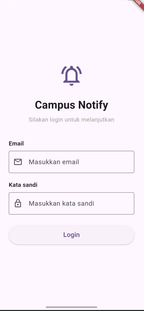
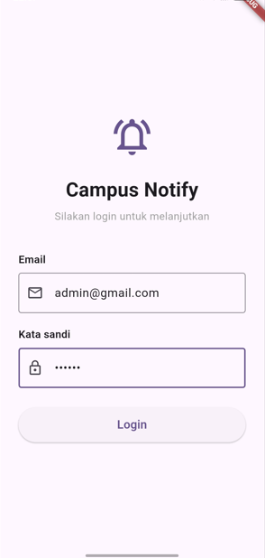
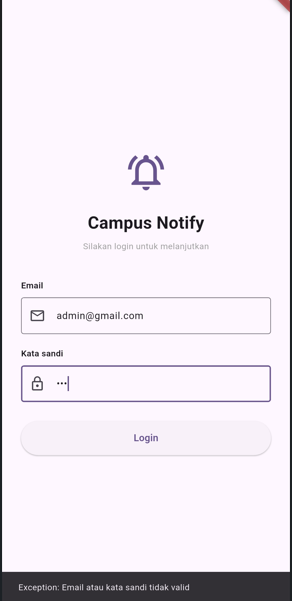
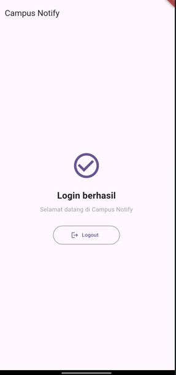
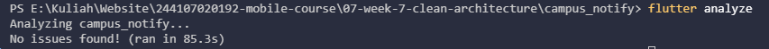

# Minggu 7 — Clean Architecture

## Informasi Mahasiswa

| Keterangan | Data                |
| ---------- | ------------------- |
| Nama       | Wawa Elent Irawanti |
| NIM        | 244107020192        |
| Kelas      | TI-3H               |

## Praktikum 1 — Prinsip SOLID dan pemetaan layer

### Penerapan SOLID

| Prinsip                   | Penerapan pada project                                                                                                                           |
| ------------------------- | ------------------------------------------------------------------------------------------------------------------------------------------------ |
| **Single Responsibility** | Widget notes menampilkan state dan UI; pemetaan data berada di `NoteModel`; akses database dilakukan oleh repository implementasi.               |
| **Open/Closed**           | Kontrak `NoteRepository` memungkinkan implementasi data diganti atau di-fake untuk test tanpa mengubah use case.                                 |
| **Liskov Substitution**   | `FakeNoteRepository` dapat menggantikan repository untuk pengujian use case dan mengembalikan kontrak hasil yang sama.                           |
| **Interface Segregation** | Kontrak notes hanya memuat operasi yang relevan untuk notes, seperti `fetchNotes` dan `addNote`, bukan kontrak besar gabungan auth/push/catatan. |
| **Dependency Inversion**  | `GetNotes` bergantung pada abstraksi `NoteRepository`, bukan pada SQLite atau `NoteRepositoryImpl`.                                              |

### Bukti hasil praktikum



## Praktikum 2 — Feature-first dan Clean Architecture

Struktur feature-first dipilih agar kode setiap fitur dapat ditemukan bersama, sementara setiap fitur tetap memisahkan tanggung jawab berdasarkan layer.

```text
campus_notify/lib/
├── core/
│   └── failures.dart
├── features/
│   └── notes/
│       ├── data/
│       │   ├── datasources/local/notes_database.dart
│       │   ├── models/note_model.dart
│       │   ├── providers/note_data_providers.dart
│       │   └── repositories/note_repository_impl.dart
│       ├── domain/
│       │   ├── entities/note.dart
│       │   ├── repositories/note_repository.dart
│       │   └── usecases/get_notes.dart
│       └── presentation/
│           ├── page/note_page.dart
│           ├── providers/note_providers.dart
│           └── widgets/
├── data/          # Integrasi auth/API project yang belum seluruhnya dimigrasikan
├── pages/         # Halaman project lama, termasuk auth dan announcements
└── providers/
```

### Bukti hasil praktikum

| Form email dan password                                    | Login gagal                                       |
| ---------------------------------------------------------- | ------------------------------------------------- |
|  |  |

## Praktikum 3 — Dependency injection dan unit test

Riverpod menghubungkan provider data dan provider presentation. `NotesPage` membaca `notesProvider` dan menampilkan state tanpa menjalankan query SQLite secara langsung. Use case menerima kontrak `NoteRepository`, sehingga test dapat memakai repository palsu.

### Pengujian dengan repository palsu

Di `campus_notify/test/get_notes_test.dart`, `FakeNoteRepository` menguji dua keadaan:

1. **Sukses:** use case meneruskan daftar catatan dari repository.
2. **Gagal:** use case meneruskan `LocalFailure` dan daftar kosong tanpa mengakses SQLite.

Pengujian auth/push pada `campus_notify/test/auth_push_test.dart` juga menggunakan server lokal dan fake token store/repository untuk menguji perilaku tanpa backend sungguhan.

### Bukti screenshot

| Login berhasil                                          | Flutter Analyze                                           | Flutter Test                                        |
| ------------------------------------------------------- | --------------------------------------------------------- | --------------------------------------------------- |
|  |  |  |

## AI Challenge

AI diminta mengusulkan struktur feature-first Clean Architecture untuk project `campus_notify`, memetakan file lama, membedakan use case yang diperlukan dari CRUD sederhana, serta menjelaskan wiring dependency menggunakan Riverpod. Prompt lengkap tersimpan di [`campus_notify/docs/ai-prompt.md`](campus_notify/docs/ai-prompt.md).

### Usulan AI dan keputusan akhir

| Aspek                | Usulan                                                                        | Keputusan dan alasan                                                                                                                                              |
| -------------------- | ----------------------------------------------------------------------------- | ----------------------------------------------------------------------------------------------------------------------------------------------------------------- |
| Struktur folder      | Feature-first dengan layer `presentation`, `domain`, dan `data`.              | Diterapkan pada fitur notes; auth dan announcements belum selesai dimigrasikan.                                                                                   |
| Kontrak repository   | Interface di domain dan implementasi di data.                                 | Diterapkan pada `NoteRepository` dan `NoteRepositoryImpl`.                                                                                                        |
| Use case             | Gunakan untuk operasi bisnis; hindari satu use case per CRUD tanpa kebutuhan. | `GetNotes` dipakai sebagai batas operasi domain; tidak menambah abstraksi untuk setiap operasi sederhana.                                                         |
| Entity/model         | Entity terpisah dari format JSON/SQLite.                                      | `Note` menjadi entity dan `NoteModel` menangani mapping SQLite.                                                                                                   |
| Dependency injection | Gunakan Riverpod, tanpa menambah package DI lain.                             | Dipakai untuk menghubungkan repository, use case, dan state provider. Wiring provider presentation masih perlu dirapikan karena saat ini mengimpor provider data. |
| Migrasi fitur        | Pindahkan seluruh auth dan announcements ke feature-first.                    | Belum diterapkan sepenuhnya; scope implementasi yang dapat diverifikasi saat ini adalah notes.                                                                    |

Keputusan dan verifikasi lebih lengkap tersedia di [`campus_notify/docs/architecture-decisions.md`](campus_notify/docs/architecture-decisions.md) dan [`campus_notify/docs/dependency-verification.md`](campus_notify/docs/dependency-verification.md).

## Refactoring Challenge

Challenge lanjutan dari codelab adalah menerapkan pola yang sama ke fitur kedua, mengekstrak formatting/routing ke fungsi murni, serta memastikan error teknis diubah menjadi `Failure` sebelum sampai ke UI.

| No  | Refactoring                                      | Status | Keterangan                                                                                                                                       |
| :-: | ------------------------------------------------ | :----: | ------------------------------------------------------------------------------------------------------------------------------------------------ |
|  1  | Memusatkan wiring dependency auth pada provider  |   ☑    | `tokenStoreProvider` dan `authRepositoryProvider` menjadi satu-satunya tempat pembuatan objek, sehingga widget tidak membuat repository sendiri. |
|  2  | Proses login berjalan lewat provider             |   ☑    | `AuthNotifier` memanggil repository untuk login lalu menyimpan token lewat `TokenStore`.                                                         |
|  3  | Error mentah diubah menjadi pesan ramah pengguna |   ☑    | Halaman login hanya menampilkan pesan hasil `apiErrorMessage` pada SnackBar.                                                                     |

## Checklist Verifikasi Mandiri

| No  | Checklist                                                                     |  Status  | Bukti atau Catatan                                                                                                   |
| :-: | ----------------------------------------------------------------------------- | :------: | -------------------------------------------------------------------------------------------------------------------- |
|  1  | Pemeriksaan sterilitas presentation dan domain menghasilkan nol temuan.       | Berhasil | Kedua pemeriksaan tidak menemukan import atau pemanggilan terlarang, dibuktikan pada Praktikum 3.                    |
|  2  | Interface berada di domain, implementasi di data, dan mapping hanya di model. | Berhasil | `note_repository.dart` berada di domain, sedangkan `note_repository_impl.dart` dan `note_model.dart` berada di data. |
|  3  | Widget tidak membuat repository sendiri dan semua lewat provider.             | Berhasil | Pembuatan objek hanya terjadi di provider, dibuktikan pada bagian Refactoring.                                       |
|  4  | Aplikasi berjalan identik sebelum dan sesudah refactor.                       | Berhasil | Tabel perbandingan login Week 6 dan Week 7 menunjukkan tampilan dan perilaku yang sama.                              |
|  5  | `flutter analyze` bersih dan semua test lulus.                                | Berhasil | `flutter analyze` tanpa temuan dan seluruh test lulus.                                                               |

## Tugas Refleksi

### 1. Mengapa interface repository harus berada di domain, bukan di data? Apa yang rusak bila dibalik?

Domain mendefinisikan kebutuhan bisnisnya, sehingga kontrak yang diperlukan harus dimiliki domain. Implementasi data kemudian memenuhi kontrak tersebut. Jika interface berada di data, domain harus bergantung pada layer teknis; akibatnya penggantian SQLite/API akan lebih mudah merambat ke logika bisnis dan pengujian domain.

### 2. Kapan use case benar-benar dibutuhkan, dan kapan repository langsung ke notifier sudah cukup?

Use case berguna ketika satu operasi mewakili aturan bisnis, mengorkestrasi beberapa repository, atau perlu menjadi titik uji domain yang eksplisit. Untuk operasi sederhana yang hanya meneruskan satu pemanggilan repository tanpa aturan tambahan, repository langsung dari notifier/provider bisa lebih sederhana.

### 3. Apa biaya over-engineering bagi tim kecil, dan kapan biayanya sepadan?

Use case satu-baris untuk semua CRUD menambah jumlah file, navigasi kode, dan boilerplate tanpa selalu menambah isolasi yang bermakna. Biaya abstraksi sepadan ketika aturan bisnis bertambah, operasi perlu menggabungkan beberapa sumber data, atau tim membutuhkan batas pengujian dan perubahan yang lebih jelas.

### 4. Bagian mana dari usulan AI yang ditolak atau disederhanakan, dan mengapa?

Usulan migrasi seluruh auth dan announcements tidak dinyatakan sebagai implementasi selesai karena kode yang diverifikasi masih berada di struktur lama. Use case juga tidak dibuat otomatis untuk setiap operasi CRUD. Keputusan ini menjaga laporan sesuai kondisi aktual sekaligus menghindari abstraksi yang belum diperlukan.
