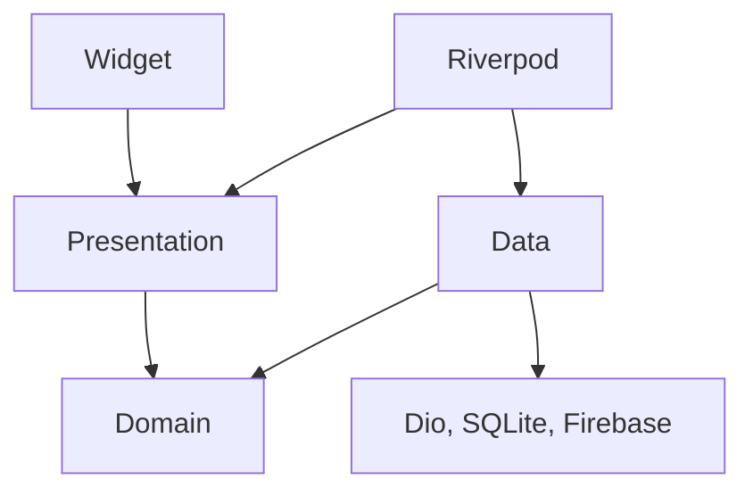

# Keputusan Arsitektur

## Ringkasan

Praktikum ini menerapkan prinsip Clean Architecture dengan memisahkan presentation, domain, dan data. Struktur feature-first digunakan agar kode auth dan announcements lebih terorganisasi. Pemisahan ini membantu menjaga domain tetap independen dari teknologi seperti Flutter, Dio, SQLite, dan Firebase.

## Keputusan Arsitektur

| Bagian | Keputusan dan Alasan |
|---|---|
| Struktur fitur | Memisahkan auth dan announcements ke dalam layer presentation, domain, dan data agar mudah dikembangkan. |
| Repository | Menempatkan interface di domain dan implementasi di data agar aturan bisnis tidak bergantung pada teknologi penyimpanan. |
| Use case | Menggunakan repository langsung untuk CRUD sederhana. Use case ditambahkan jika terdapat aturan bisnis atau proses yang lebih kompleks. |
| Entity dan model | Entity berisi data domain, sedangkan model menangani pemetaan data API atau database. |
| Dependency injection | Menggunakan Riverpod untuk mengatur dependency agar mudah diuji dan widget tidak membuat repository sendiri. |
| FCM dan routing | Memisahkan layanan notifikasi dari domain dan mempertahankan routing pada tingkat aplikasi. |

## Pemetaan File

| File Lama | Tujuan |
|---|---|
| `lib/data/auth_repository.dart` | Memisahkan kontrak dan implementasi repository auth. |
| `lib/data/api_client.dart` | Menempatkan komunikasi API pada layer data atau jaringan bersama. |
| `lib/data/api_errors.dart` | Memisahkan penanganan error teknis dari UI. |
| `lib/data/token_store.dart` | Menempatkan penyimpanan token pada datasource lokal. |
| `lib/providers/auth_provider.dart` | Mengatur state auth dan dependency melalui Riverpod. |
| `lib/pages/login_page.dart` | Memindahkan halaman login ke presentation auth. |
| `lib/pages/home_page.dart` | Menempatkan halaman utama pada presentation aplikasi. |
| `lib/pages/announcement_page.dart` | Memindahkan halaman pengumuman ke presentation announcements. |
| `lib/services/push_service.dart` | Memisahkan integrasi FCM dari domain. |
| `lib/routes.dart` dan `lib/main.dart` | Mempertahankan routing dan inisialisasi aplikasi. |
| `lib/features/notes/` | Mempertahankan struktur Clean Architecture yang sudah tersedia. |

## Verifikasi

- ✅ Interface repository dipisahkan dari implementasinya.
- ✅ Domain diperiksa agar bebas dari import teknis.
- ✅ Penggunaan use case dievaluasi untuk menghindari over-engineering.
- ✅ Entity dipisahkan dari mapping data.
- ✅ Dependency injection menggunakan Riverpod.
- ✅ Pemeriksaan dependency rule berhasil.
- ✅ `flutter analyze` dan `flutter test` berhasil.
- ✅ Pengujian fitur dan dokumentasi telah diselesaikan.

## Diagram Dependensi

## Tabel Usulan dan Keputusan Final

| Aspek | Usulan AI | Keputusan Final |
|---|---|---|
| Struktur fitur | Feature-first Clean Architecture. | Notes sudah menerapkan struktur berlapis, auth dan announcements belum sepenuhnya dimigrasikan. |
| Repository | Interface di domain, implementasi di data. | Diterapkan pada notes. |
| Use case | Digunakan sesuai kebutuhan. | Dipakai untuk proses kompleks agar tidak over-engineering. |
| Entity dan model | Dipisahkan. | `Note` dan `NoteModel` terpisah. |
| Dependency injection | Menggunakan Riverpod. | Sudah digunakan, tetapi dependency provider masih perlu dirapikan. |
| FCM dan routing | Dipisahkan dari domain. | Mengikuti struktur aplikasi yang tersedia. |

## Dokumentasi AI Challenge

- ✅ `docs/ai-prompt.md` berisi prompt asli.
- ✅ `docs/architecture-decisions.md` berisi keputusan arsitektur.
- ✅ `docs/dependency-verification.md` berisi hasil pemeriksaan.
- ✅ Diagram dependensi tersedia untuk persiapan demo.