## Week 8

## Praktikum 1 Hygiene branch dan commit

<br> Praktikum ini dilakukan untuk memeriksa riwayat pengembangan project serta memahami penggunaan Git dalam mengelola perubahan kode.<br>

<p align="center">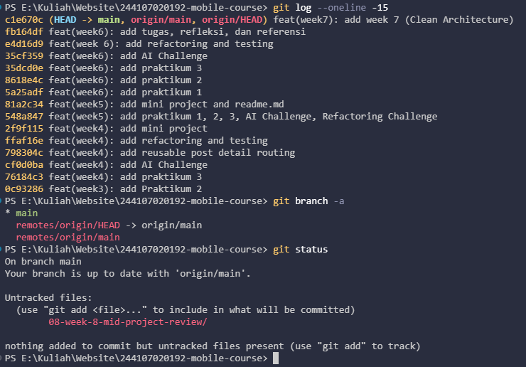</p>

<li> Memeriksa riwayat commit, daftar branch, dan status repository untuk mengetahui aktivitas serta perubahan pada project.</li><br>

<p align="center">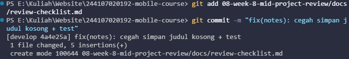</p>

<li> Memastikan perubahan yang akan di-commit sudah sesuai, terfokus pada satu pekerjaan, dan memiliki pesan commit yang jelas.</li><br>

<p align="center">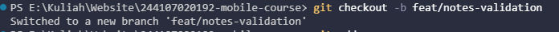</p>

<li> Berpindah ke branch yang sesuai untuk mengerjakan atau memeriksa perubahan project.</li><br>

<p align="center">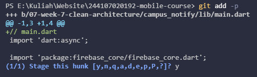</p>

<li> Memilih dan menambahkan file yang mengalami perubahan ke staging area sebelum commit.</li><br>

<p align="center">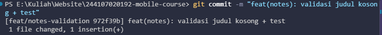</p>

<li> Menyimpan perubahan ke riwayat Git menggunakan pesan commit yang menjelaskan perubahan yang dilakukan.</li><br>

<p align="center">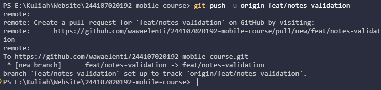</p>

<li> Mengirim commit ke repository GitHub agar perubahan tersimpan di remote repository.</li><br>


## Praktikum 2: PR dan peer review

Praktikum ini menerapkan alur kolaborasi GitHub, mulai dari membuat issue hingga menggabungkan perubahan melalui pull request.

1. Membuat Github Issue

<li>Issue dibuat untuk mencatat masalah validasi judul catatan kosong yang perlu diperbaiki.</li><br>

<p align="center">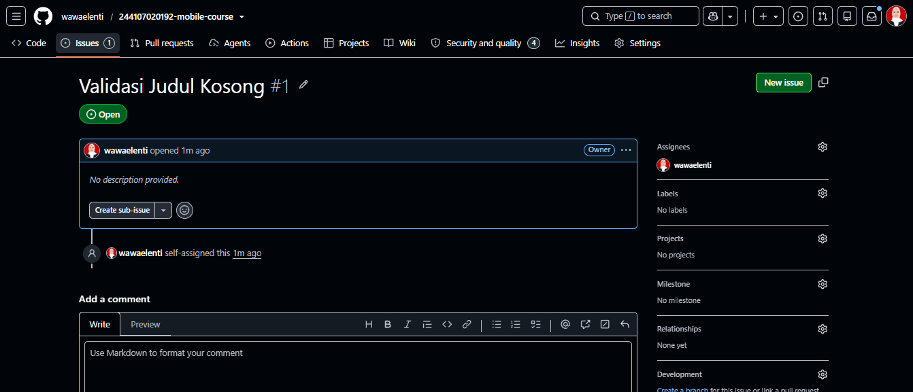</p>

2.  Membuat Pull Request

<li>Pull request diajukan dari branch feat/notes-validation ke develop, disertai penjelasan masalah, solusi, dan cara pengujian.</li><br>

<p align="center">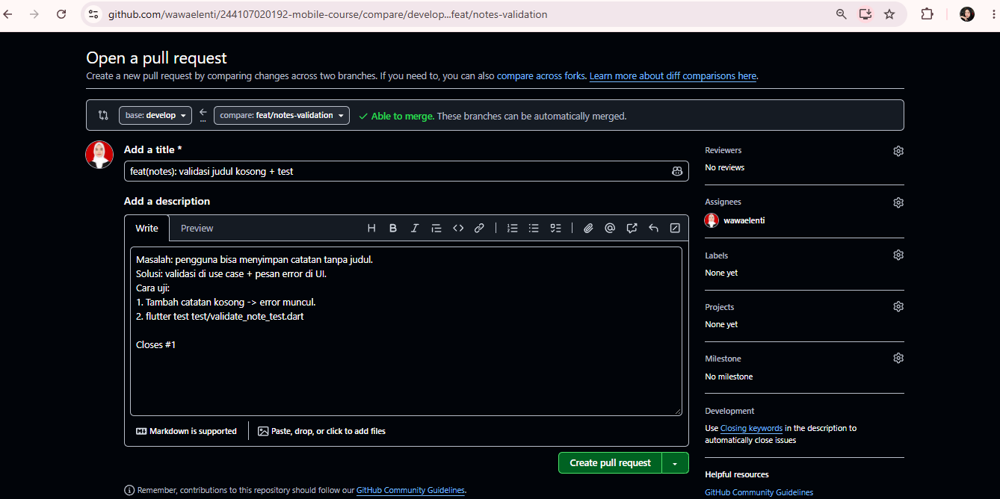</p>

3. Review Pull Request

<li>Perubahan kode diperiksa untuk memastikan solusi sesuai kebutuhan dan pengujian tersedia.</li><br>

<p align="center">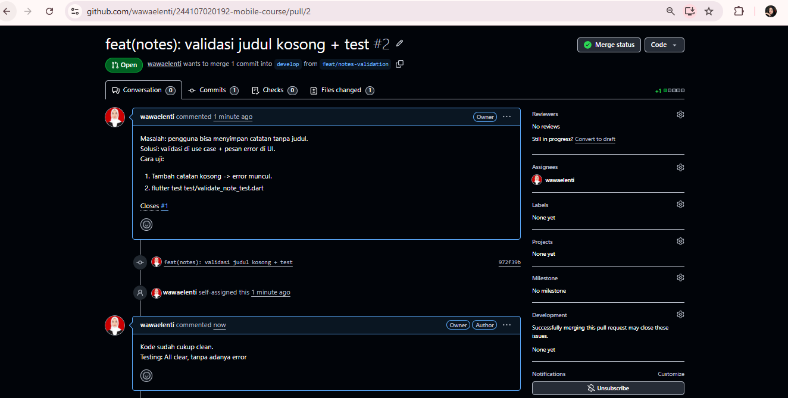</p>

4. Merge Pull Request

<li>Pull request digabungkan ke branch develop setelah proses pemeriksaan selesai.</li><br>

<p align="center">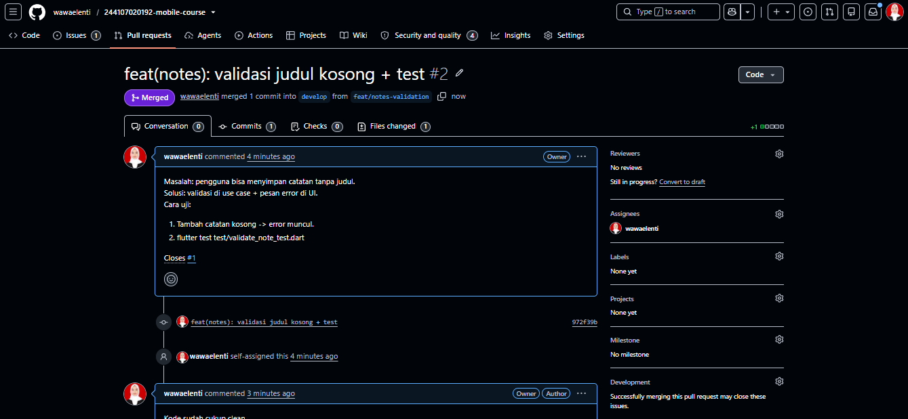</p>


## Praktikum 3: Static analysis dan mid review

1. Pemeriksaan Kualitas Kode

Pemeriksaan dilakukan menggunakan flutter analyze, dart format --set-exit-if-changed ., dan flutter test untuk memastikan kode rapi, tidak memiliki masalah analisis, dan pengujian berjalan dengan baik.

<p align="center">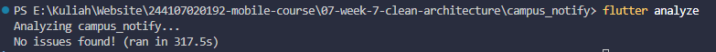</p>

<p align="center">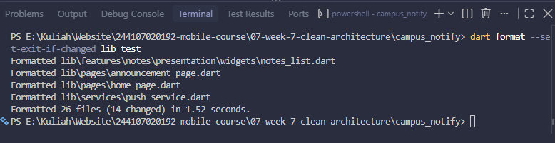</p>

<p align="center">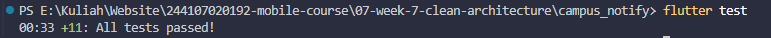</p>

2. Konfigurasi Continuous Integration (CI)

File .github/workflows/ci.yml digunakan untuk menjalankan pemeriksaan otomatis ketika ada pull request.

<p align="center">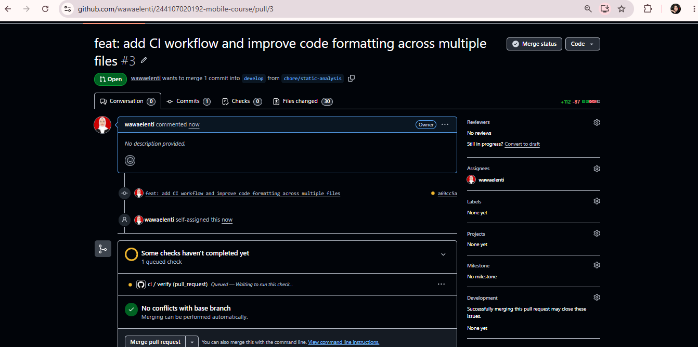</p>

3. Hasil Pemeriksaan CI

GitHub Actions digunakan untuk melihat hasil pemeriksaan otomatis dan memastikan workflow berjalan dengan sukses.

<p align="center">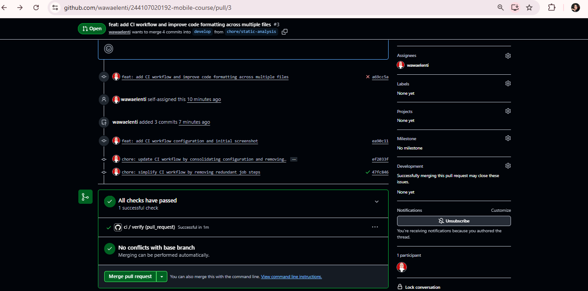</p>

4. Mid Review Checklist

Kesiapan project dievaluasi berdasarkan struktur arsitektur, hasil analisis kode, pengujian, kualitas commit dan pull request, serta kelengkapan README dan dokumentasi.

Dokumentasi checklist disimpan pada docs/review-checklist.md.

## AI Challenge

## 1. Informasi Review

- **Pull Request:** PR #3
- **Branch:** `chore/static-analysis` → `develop`
- **Fokus review:** Static analysis, formatting, testing, CI, dan arsitektur aplikasi `campus_notify`.

## 2. Hasil Verifikasi

| Pemeriksaan | Hasil |
|---|---|
| `flutter analyze` | Tidak ditemukan masalah |
| `flutter test` | 11 test berhasil |
| `dart format --output=none --set-exit-if-changed lib test` | 26 file sudah terformat, 0 perubahan |
| Pemeriksaan dependency | Ditemukan import dari layer data pada presentation |
| Pemeriksaan CI | Workflow menjalankan `pub get`, `analyze`, dan `test` |
| GitHub Actions | Check `verify` berhasil |

## 3. Temuan AI dan Keputusan

### Temuan 1: Presentation Mengakses Provider dari Layer Data

**Hasil verifikasi:** Benar.

File `note_providers.dart` mengimpor `note_data_providers.dart` dari layer data dan menggunakan `noteRepositoryProvider`. Hal ini menunjukkan adanya ketergantungan langsung presentation terhadap layer data.

**Keputusan:** Diterima sebagai perbaikan lanjutan.

**Alasan:** Ketergantungan tersebut perlu dievaluasi agar sesuai dengan prinsip Clean Architecture. Namun, temuan ini bukan penghambat PR karena sudah ada sebelum perubahan formatting.

**Saran:** Gunakan kontrak repository pada layer domain dan atur dependency melalui composition root.

### Temuan 2: CI Belum Memiliki Pemeriksaan Aturan Dependency

**Hasil verifikasi:** Benar.

Workflow CI belum memiliki pemeriksaan khusus untuk memastikan aturan dependency antar-layer tetap sesuai dengan arsitektur aplikasi.

**Keputusan:** Diterima sebagai perbaikan lanjutan.

**Alasan:** Pemeriksaan ini dapat membantu mencegah pelanggaran arsitektur pada perubahan berikutnya.

**Saran:** Tambahkan architecture test atau pemeriksaan dependency ke workflow CI.

### Temuan 3: CI Belum Memeriksa Formatting Dart

**Hasil verifikasi:** Benar.

Workflow CI belum menjalankan pemeriksaan formatting Dart secara otomatis. Pemeriksaan lokal menunjukkan bahwa 26 file sudah terformat dan tidak memerlukan perubahan.

**Keputusan:** Diterima sebagai peningkatan CI.

**Alasan:** Pemeriksaan formatting otomatis membantu menjaga konsistensi kode dan mencegah format yang tidak sesuai masuk ke branch utama.

**Saran:** Tambahkan perintah berikut ke workflow CI:

```bash
dart format --output=none --set-exit-if-changed lib test
```

### Temuan 4: Versi Flutter pada CI Belum Dikunci

**Hasil verifikasi:** Benar sebagai potensi risiko.

Workflow menggunakan channel Flutter stable tanpa mengunci versi SDK secara spesifik.

**Keputusan:** Diterima sebagai saran peningkatan reliabilitas.

**Alasan:** Versi SDK yang berubah dapat memengaruhi konsistensi hasil build dan pengujian.

**Saran:** Gunakan versi Flutter yang sudah diverifikasi agar hasil CI lebih konsisten.

### Temuan 5: Constructor Satu Baris Perlu Dikembalikan ke Format Multibaris

**Hasil verifikasi:** Tidak cukup kuat untuk dianggap sebagai masalah.

Pemeriksaan formatter menunjukkan bahwa tidak ada perubahan formatting yang diperlukan. Selain itu, tidak ditemukan masalah perilaku yang disebabkan oleh format constructor tersebut.

**Keputusan:** Ditolak.

**Alasan:** Temuan ini hanya berupa preferensi gaya penulisan dan bukan masalah fungsional atau pelanggaran aturan formatting.

## 4. Kesimpulan

Hasil pemeriksaan menunjukkan bahwa `flutter analyze` berhasil tanpa masalah dan seluruh 11 test berhasil dijalankan. Pemeriksaan formatting juga menunjukkan bahwa 26 file sudah sesuai format.

Review menemukan beberapa peluang perbaikan pada arsitektur dan workflow CI. Temuan tersebut diterima sebagai perbaikan lanjutan, sedangkan saran formatting constructor ditolak karena tidak didukung masalah teknis yang jelas.

Tidak ada perubahan kode aplikasi yang diterapkan selama proses review ini.


# Refactoring, Testing, dan Error Umum

## 1. Refactoring Challenge

Refactoring dilakukan untuk menjaga kualitas kode, mempermudah proses review, dan mengurangi potensi kesalahan. Perubahan kode perlu melalui review dan pengujian sebelum di-merge.

Hal yang perlu diperhatikan:
- Menindaklanjuti komentar `Request changes` hingga reviewer memberikan approval.
- Menggunakan `dart format` dan CI untuk menjaga konsistensi kode.
- Membagi perubahan besar menjadi beberapa PR kecil agar mudah diperiksa.

## 2. Testing

Pengujian dilakukan untuk memastikan kode tidak memiliki masalah dan fitur tetap berjalan dengan baik.

Perintah pengujian yang digunakan:

```bash
flutter analyze
flutter test
dart format --output=none --set-exit-if-changed lib test
```

Selain pengujian otomatis, dilakukan pengujian manual pada fitur login untuk memastikan fitur berjalan sesuai harapan.

## 3. Hasil Verifikasi

| Pengujian | Hasil |
|---|---|
| `flutter analyze` | Berhasil, tidak ditemukan masalah |
| `dart format` | Berhasil, format kode sesuai |
| `flutter test` | Berhasil, seluruh test lulus |
| CI | Berhasil, proses pemeriksaan selesai |
| Manual test login | Fitur login diuji secara manual |

## 4. Error Umum dan Solusinya

| Masalah | Solusi |
|---|---|
| PR terlalu besar | Pecah perubahan berdasarkan fitur |
| Konflik merge | Sinkronkan branch dengan `develop` secara rutin |
| Perbedaan format kode | Gunakan `dart format` dan CI |
| Bug lolos saat review | Jalankan aplikasi dan lakukan pengujian |
| Saran AI tidak sesuai arsitektur | Verifikasi dengan kode dan hasil pengujian |

## 5. Screenshot

### CI Success
Bukti workflow CI berhasil dijalankan.

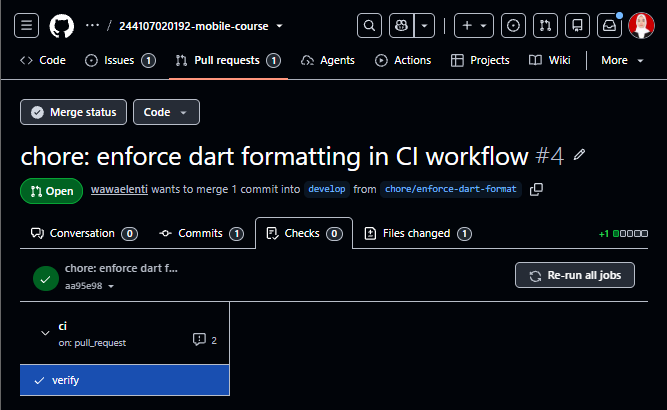

### Dart Format
Bukti pemeriksaan format kode Dart.

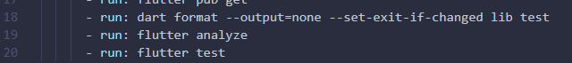

### Flutter Analyze
Bukti analisis kode berhasil tanpa masalah.

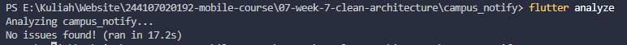

### Flutter Test
Bukti pengujian otomatis berhasil dijalankan.

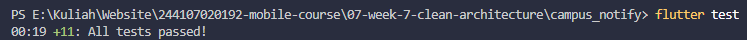

### Manual Test Login
Bukti pengujian fitur login secara manual.

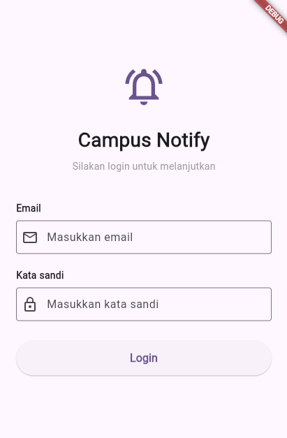

## 6. Kesimpulan

Refactoring, code review, dan testing membantu menjaga kualitas aplikasi. Pemeriksaan otomatis melalui formatter, analyzer, test, dan CI, serta pengujian manual pada fitur login, menjadi langkah verifikasi sebelum perubahan digabungkan ke branch utama.


## Tugas, Refleksi, dan Referensi

### 1. Mini Project / Industry Challenge

Mini project Minggu 8 melanjutkan pengembangan repository portfolio dari Minggu 5–7, bukan membuat project baru. Fokus kegiatan ini adalah menerapkan kolaborasi melalui GitHub, code review, testing, dan dokumentasi hasil review AI.

### A. Issue dan Pull Request

Issue digunakan untuk mencatat pekerjaan yang perlu dilakukan, sedangkan Pull Request (PR) digunakan untuk mengajukan perubahan agar diperiksa oleh reviewer sebelum di-merge ke branch `develop`.

Alur kolaborasi yang digunakan:

`Issue → Feature Branch → Pull Request → Review → Merge`

Bukti pembuatan issue dan Pull Request ditampilkan berikut.

**Create GitHub Issue**


**Create Pull Request**


**Review Pull Request**


**Merge Pull Request**


### B. Template Pull Request

Pull Request perlu menjelaskan masalah yang diperbaiki, solusi yang diterapkan, cara pengujian, dan bukti screenshot agar reviewer dapat memahami perubahan dengan mudah.

### C. Hasil Testing

Pengujian dilakukan untuk memastikan kualitas kode dan kestabilan aplikasi sebelum perubahan digabungkan.

- `flutter analyze`: tidak ditemukan masalah.
- `flutter test`: seluruh 11 test berhasil.
- `dart format`: 26 file sudah terformat dan tidak memerlukan perubahan.
- CI: pemeriksaan berhasil dijalankan.

### D. Dokumentasi Review AI

Dokumentasi review AI disimpan pada folder `docs/`, meliputi prompt yang digunakan, perbandingan usulan AI dengan keputusan akhir, alasan menerima atau menolak temuan, serta bukti verifikasi.

Dokumentasi utama: `docs/ai-review-vs-keputusan.md`.

## 2. Refleksi

1. Apa beda LGTM buta dengan approve yang bertanggung jawab?Apa risikonya bagi tim?

= LGTM buta adalah memberikan persetujuan tanpa memeriksa kode atau menjalankan pengujian. Sebaliknya, approve yang bertanggung jawab dilakukan setelah reviewer memahami perubahan, memeriksa kode, dan memastikan pengujian berhasil. LGTM buta berisiko menyebabkan bug dan masalah arsitektur masuk ke branch utama.

2. Kapan komentar wajib berstatus Request Changes, dan kapan cukup saran?

= Request Changes digunakan ketika terdapat masalah penting, seperti bug, kesalahan logika, atau pelanggaran aturan arsitektur yang perlu diperbaiki sebelum merge. Saran cukup diberikan untuk perbaikan yang tidak menghambat fungsi aplikasi, seperti preferensi gaya penulisan atau alternatif implementasi.

3. Bagian mana dari review AI yang ditolak atau disederhanakan, dan mengapa?

= Saran AI untuk mengubah format constructor menjadi beberapa baris ditolak karena tidak menunjukkan masalah fungsional dan tidak diperlukan oleh formatter. Sementara itu, temuan terkait ketergantungan antar-layer dan kekurangan pemeriksaan CI diterima sebagai bahan perbaikan lanjutan setelah diverifikasi menggunakan kode dan konfigurasi workflow.

4. Satu hal konkret yang diperbaiki setelah review sejawat dan dampaknya

= Salah satu perbaikan konkret adalah memastikan kode diperiksa melalui `flutter analyze`, `flutter test`, dan formatter sebelum perubahan digabungkan. Hal ini membantu menemukan masalah lebih awal dan menjaga konsistensi kode.


