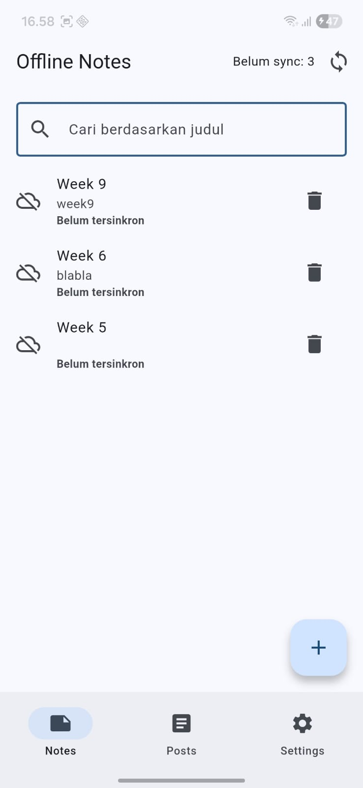
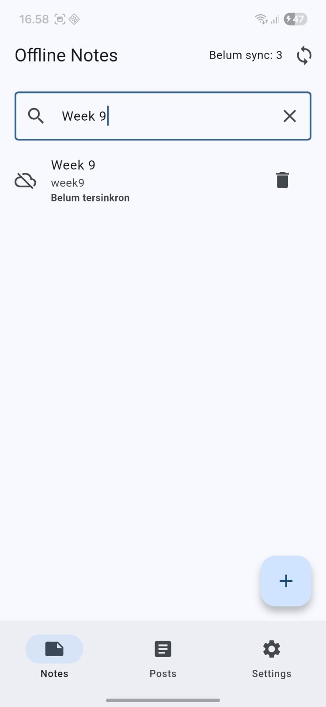
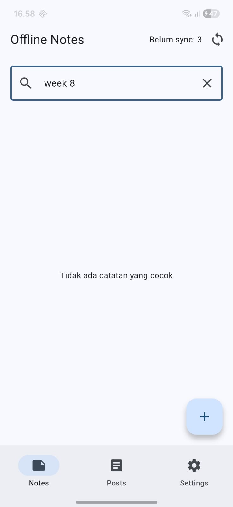
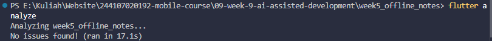
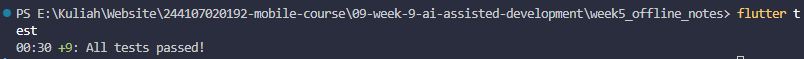
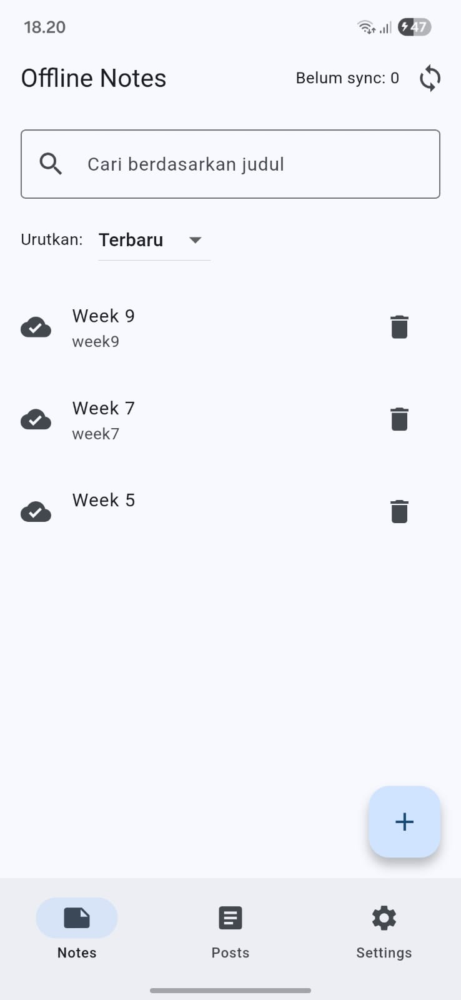
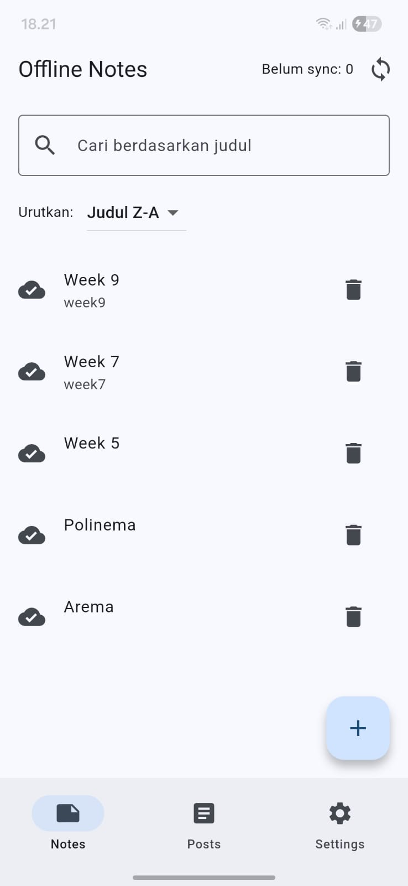

# Week 9 - Praktikum 1, 2, dan 3

Project praktikum menggunakan `week5_offline_notes` dari Week 5. Praktikum 1
berfokus pada prompt dan context engineering; Praktikum 2 menghasilkan fitur
pencarian judul catatan; Praktikum 3 mendebug dan memverifikasi pemisahan
logika search ke fungsi domain yang bisa diuji. Mini project juga menyediakan
pilihan sorting catatan.

## Praktikum 1: Prompt dan context engineering

Prompt memakai lima slot: peran, konteks, tugas, batas, dan output. Konteks
dibatasi ke halaman catatan, `NoteRepository`, model `Note`, dan versi dependency
yang relevan. Prompt mentah dan catatan konteks ada di
[docs/ai-log.md](./docs/ai-log.md).

## Praktikum 2: Search judul

- Pencarian dilakukan pada daftar catatan yang dimuat melalui repository lokal.
- Pencocokan judul tidak peka huruf besar/kecil dan mengabaikan spasi di awal
  atau akhir query.
- Query kosong menampilkan semua catatan.
- Jika database berisi catatan tetapi tidak ada judul cocok, tampil empty state
  `Tidak ada catatan yang cocok`. Jika database kosong, pesan awal
  `Belum ada catatan` tetap digunakan.
- Fungsi filter berada di `lib/domain/filter_notes.dart`, generik, dan tidak
  mengimpor Flutter, Dio, SQLite, atau layer data.
- Tidak ada perubahan pada repository, schema SQLite, atau fitur offline.

### Bukti hasil Praktikum 2

| Query kosong                                                                     | Hasil pencarian                                                                            | Tidak ada hasil                                                                       |
| -------------------------------------------------------------------------------- | ------------------------------------------------------------------------------------------ | ------------------------------------------------------------------------------------- |
|  |  |  |

### Menjalankan verifikasi

```powershell
cd week5_offline_notes
flutter analyze
flutter test
```

Test mencakup pencarian case-insensitive, query kosong, query tak cocok, dan
empty state pada halaman catatan.

### Hasil verifikasi

- `flutter analyze`: lulus, tidak ada issue.
- `flutter test`: lulus, seluruh 13 test berhasil.
- `dart format --set-exit-if-changed` pada file Dart yang diubah: lulus.
- Aplikasi tidak dijalankan; uji manual belum dilakukan sesuai permintaan.

### Uji manual

Jalankan project sendiri bila siap untuk menguji:

1. Query kosong: semua catatan muncul.
2. Query yang cocok, termasuk beda kapitalisasi: judul terkait muncul.
3. Query yang tidak cocok: empty state `Tidak ada catatan yang cocok` muncul.

Project tidak dijalankan selama pengerjaan ini sesuai permintaan.

## Praktikum 3: Debug dan refactor

### Debug dengan test merah

Reproduksi bug: cari `belanja` pada daftar dengan judul `Belanja Mingguan`
dan `Catatan belanja`. Draft case-sensitive hanya menemukan satu catatan.
Unit test membuktikan hasil yang diharapkan adalah dua catatan; setelah judul
dan query dinormalisasi dengan `toLowerCase()`, test lulus.

### Hasil refactor

- Aturan pencarian berada di `lib/domain/filter_notes.dart` dalam fungsi murni
  `filterNotes`, sehingga tidak bergantung pada widget, Riverpod, SQLite, atau
  Dio.
- Fungsi filter kurang dari 40 baris dan menerima fungsi `titleOf`; UI dapat
  memberikan judul tanpa membuat domain bergantung pada model data.
- `NotesPage` menangani input dan tampilan state saja, sementara operasi
  penyimpanan tetap melalui repository yang sudah ada.
- Tidak ada import lintas layer pada fungsi domain dan tidak ada perubahan
  skema atau perilaku offline.

### Verifikasi akhir

```powershell
cd week5_offline_notes
flutter analyze
dart format --set-exit-if-changed lib/domain/filter_notes.dart lib/pages/notes_page.dart test/search_filter_test.dart test/notes_search_test.dart
flutter test
```

Hasil verifikasi akhir: `flutter analyze` bersih, format tidak mengubah file,
dan seluruh test lulus. Pemeriksaan `dart format --set-exit-if-changed .` untuk
seluruh project tidak dapat menyelesaikan directory listing karena ada path
generated yang hilang di `build/`; pemeriksaan format pada file Dart yang
diubah lulus. Aplikasi tidak dijalankan; uji manual tidak dilakukan.

## AI Challenge: review search

Review dilakukan dengan fokus kebenaran, arsitektur, dan test. Satu temuan
terkonfirmasi: widget test sebelumnya hanya menguji empty state, belum menguji
hasil pencarian yang cocok dan aksi clear. Test untuk hasil cocok + clear
ditambahkan; seluruh 13 test lulus. Dua saran lain—optimasi query database untuk
koleksi besar dan memindahkan query ke Riverpod—ditolak karena belum ada bukti
masalah performa, sedangkan query saat ini hanya state sementara halaman.

Prompt, tiga temuan lengkap dan tabel usulan-vs-keputusan per file dicatat di [docs/ai-log.md](./docs/ai-log.md).

### Bukti verifikasi AI Challenge

- `flutter analyze`: lulus, tidak ada issue.
- `flutter test`: lulus, seluruh 13 test berhasil setelah sorting ditambahkan.
- `dart format --set-exit-if-changed test/notes_search_test.dart`: lulus tanpa perubahan setelah format.
- `test/notes_search_test.dart`: bukti integrasi hasil cocok, no-match, serta aksi clear menggunakan fake repository.

## Refactoring Challenge

1. **Perkecil dan isolasi logika search.** Aturan filter ditempatkan pada
   `lib/domain/filter_notes.dart` sebagai fungsi kecil yang bisa diuji
   independen. `NotesPage` tetap berisi UI dan state halaman; tidak dipindahkan
   seluruhnya karena file tersebut juga memuat tambah/hapus/sinkronisasi yang
   berada di luar lingkup refactor.
2. **Pindahkan filter dari widget ke domain.** `filterNotes<T>` menerima
   callback `titleOf`, lalu mengembalikan catatan yang cocok. Fungsi tidak
   mengimpor Flutter, Riverpod, SQLite, Dio, atau model data.
3. **Hapus import lintas layer.** Widget mengimpor fungsi domain; unit test
   menguji aturan tanpa widget/database. Operasi data tetap lewat repository.

### Checklist verifikasi mandiri

- [x] Prompt lima slot dan konteks project tersedia di
      [docs/ai-log.md](./docs/ai-log.md).
- [x] Search dipisah menjadi fungsi domain murni yang ringkas dan bisa diuji.
- [x] Tidak ada import Flutter, Dio, SQLite, atau data layer pada fungsi domain.
- [x] `flutter analyze` lulus tanpa issue.
- [x] `flutter test test/search_filter_test.dart` lulus.
- [x] Widget test empty state dan hasil cocok/clear lulus.
- [x] `flutter test` lulus: seluruh 13 test berhasil.
- [x] Temuan AI dibuktikan dengan test dan diperbaiki; saran lain ditolak
      dengan alasan teknis di [docs/ai-log.md](./docs/ai-log.md).
- [x] Bukti manual tiga query:
      [query kosong](./screenshots/prak2_empty-string.jpeg),
      [hasil cocok](./screenshots/prak2_success-search.jpeg), dan
      [hasil tidak cocok](./screenshots/prak2_not-found.jpeg).
- [x] Screenshot hasil `flutter analyze` tersedia:
      
- [x] Screenshot hasil `flutter test` tersedia:
      

### Error umum dan pencegahannya

| Gejala                            | Pencegahan pada praktikum                                                                |
| --------------------------------- | ---------------------------------------------------------------------------------------- |
| Memakai method/API yang tidak ada | Gunakan API Dart yang diverifikasi dan jangan menambah package untuk filter sederhana.   |
| Import lintas layer               | Jaga domain tetap murni; berikan judul melalui callback.                                 |
| Semua test merah                  | Isolasi aturan filter dan uji hasil cocok, query kosong, serta no-match secara terpisah. |
| Mengulang prompt tanpa bukti      | Reproduksi bug lewat test merah sebelum memperbaiki.                                     |
| Tidak bisa menjelaskan hasil AI   | Baca fungsi filter, alur pemanggil di widget, dan keputusan teknis di ai-log.            |

## Mini project / Industry Challenge

### Fitur

Fitur yang ditambahkan adalah pencarian catatan berdasarkan judul pada halaman
Notes. Pencarian tidak membedakan kapitalisasi, mengabaikan spasi di awal/akhir
query, dan menampilkan empty state `Tidak ada catatan yang cocok` jika tidak
ada judul yang cocok. Query kosong menampilkan semua catatan. Pengguna juga
dapat mengurutkan hasil berdasarkan terbaru, judul A-Z, atau judul Z-A. Data
tetap dibaca melalui repository lokal sehingga fitur daftar catatan offline
tidak berubah.

### Stack

- Flutter / Dart (SDK project: Dart `^3.13.1`)
- Riverpod `^3.4.3` untuk state/provider halaman
- SQLite melalui `sqflite ^2.4.4` dan `NoteRepository`
- Dio `^5.11.1` untuk fitur posts project Week 5; tidak dipakai oleh search
- Unit test dan widget test melalui `flutter_test`

Prompt inti: sebagai senior Flutter developer, tambahkan search judul yang
case-insensitive dan empty state, pertahankan offline/repository, pisahkan
filter ke fungsi domain murni, lalu sertakan test. Prompt lengkap, konteks yang
diberikan, dan output awal AI tercatat di [docs/ai-log.md](./docs/ai-log.md).

### Menjalankan dan menguji

```powershell
cd 09-week-9-ai-assisted-development\week5_offline_notes
flutter pub get
flutter run
```

Verifikasi:

```powershell
flutter analyze
flutter test
```

`flutter analyze` selesai tanpa issue dan seluruh 13 test lulus. Bukti tangkapan
layar: [hasil analyze](./screenshots/fluuter-analyze.png) dan
[hasil test](./screenshots/flutter-test.png). Screenshot test adalah bukti run
sebelum sorting ditambahkan; jumlah aktual terbaru diverifikasi dari terminal.
Tiga skenario search UI juga tersedia
sebagai [query kosong](./screenshots/prak2_empty-string.jpeg),
[hasil cocok](./screenshots/prak2_success-search.jpeg), dan
[hasil tidak cocok](./screenshots/prak2_not-found.jpeg).

### Keputusan saran AI

| Saran                                                     | Keputusan       | Alasan teknis dan bukti                                                                                                                                |
| --------------------------------------------------------- | --------------- | ------------------------------------------------------------------------------------------------------------------------------------------------------ | ----------------------------------------------------------------------------------------------------------------------------------- |
| Letakkan filter pada fungsi domain murni.                 | Terima          | `rg -n "filterNotes                                                                                                                                    | toLowerCase" lib/domain`menunjukkan filter terisolasi;`flutter test test/search_filter_test.dart` lulus (6 test, termasuk sorting). |
| Tambahkan widget test untuk hasil cocok dan tombol clear. | Terima          | Test memverifikasi judul cocok, hasil lain tersembunyi, dan daftar pulih setelah clear. `flutter test test/notes_search_test.dart` lulus (3 test).     |
| Tambahkan sorting terbaru, judul A-Z, dan judul Z-A.      | Terima          | Sorting diletakkan di `lib/domain/sort_notes.dart`, mengembalikan copy agar input tidak berubah; unit dan widget test membuktikan urutan yang dipilih. |
| Pindahkan query ke SQLite atau SharedPreferences.         | Tolak           | Query hanya state sementara UI, bukan data catatan atau preferensi; tidak diperlukan untuk mempertahankan fungsi offline.                              |
| Pindahkan state query ke Riverpod sekarang.               | Tolak           | Query hanya dipakai satu halaman, belum perlu dibagikan atau dipulihkan; tambahan state/provider tidak memberi kebutuhan fungsional.                   |
| Optimalkan pencarian untuk dataset besar.                 | Tolak sementara | Belum ada bukti ukuran dataset atau hasil profiling yang menunjukkan bottleneck; tetap cari di list lokal yang sudah dimuat.                           |

Prompt inti, konteks terpilih, draft awal AI, output review, dan bukti
verifikasi tercatat di [docs/ai-log.md](./docs/ai-log.md).

Sorting ditambahkan sebagai perluasan kecil industry challenge setelah fitur
search awal. Implementasi dan verifikasinya dijelaskan di bagian
[Sorting catatan](#sorting-catatan).

### Sorting catatan

Dropdown **Urutkan** menyediakan:

- **Terbaru** — `updatedAt` paling baru lebih dahulu (default, sama dengan
  urutan awal repository).
- **Judul A-Z** — urutan alfabetis case-insensitive.
- **Judul Z-A** — urutan alfabetis terbalik case-insensitive.

Sorting diterapkan setelah pencarian, sehingga pilihan berlaku pada hasil
filter dan tidak mengubah daftar asal.

Sorting diverifikasi dengan unit test A-Z/Z-A dan urutan terbaru (termasuk
memastikan list input tidak termutasi), serta widget test yang memilih A-Z dan
memastikan posisi catatan berubah. Screenshot hasil UI:

| Terbaru                                                        | Judul Z-A                                                                 |
| -------------------------------------------------------------- | ------------------------------------------------------------------------- |
|  |  |

## Refleksi

- **Satu halusinasi AI apa yang ditemukan dan bagaimana membuktikannya?** Draft
  awal filter menggunakan pencocokan case-sensitive. Test dengan query
  `belanja` terhadap judul `Belanja Mingguan` membuktikan draft itu melewatkan
  hasil yang seharusnya cocok. Setelah query dan judul dinormalisasi dengan
  `toLowerCase()`, test lulus dan kedua catatan dengan variasi kapitalisasi
  ditemukan.
- **Prompt mana yang paling membantu dan apa yang diubah?** Prompt review
  sebagai senior Flutter developer yang membatasi fokus pada kebenaran,
  arsitektur, dan test paling membantu mengungkap kekurangan widget test untuk
  hasil cocok dan aksi clear. Saya menerima temuan itu dengan menambahkan
  widget test, tetapi menolak optimasi performa dan pemindahan query ke
  Riverpod karena belum ada bukti bottleneck atau kebutuhan berbagi state.
- **Satu refactor apa yang dilakukan pada kode AI?** Logika filter dipindahkan
  dari widget ke fungsi domain murni `filterNotes<T>` di
  `lib/domain/filter_notes.dart`. Fungsi menerima callback `titleOf`, sehingga
  bisa diuji tanpa bergantung pada Flutter, database, atau model data; widget
  tetap menangani input dan tampilan state.
- **Keputusan terima/tolak mana yang paling sulit?** Menolak pemindahan query
  ke Riverpod terasa paling sulit karena project memang menggunakan Riverpod.
  Namun query hanya dipakai sebagai state sementara di satu halaman, jadi
  menambah provider belum memberi manfaat yang dibutuhkan. Saya memilih
  mempertahankan state lokal sampai ada kebutuhan berbagi atau memulihkan query.
