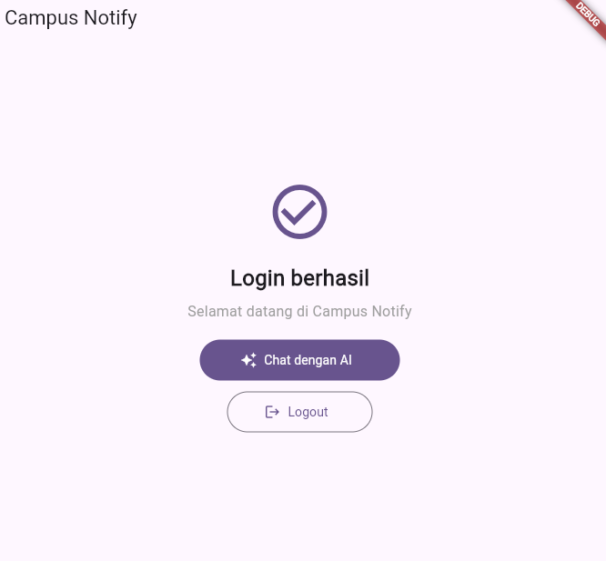
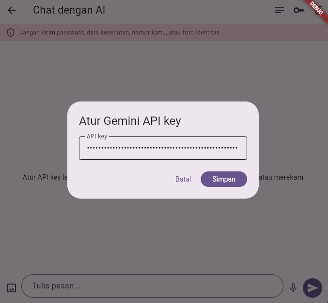
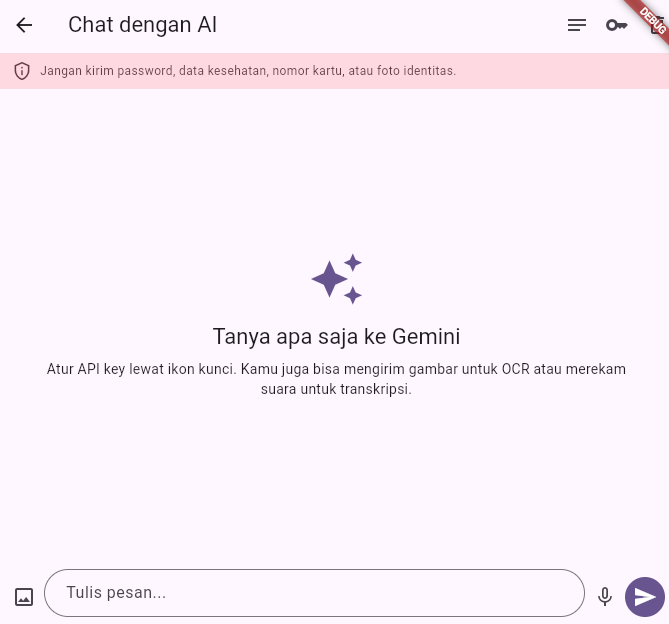
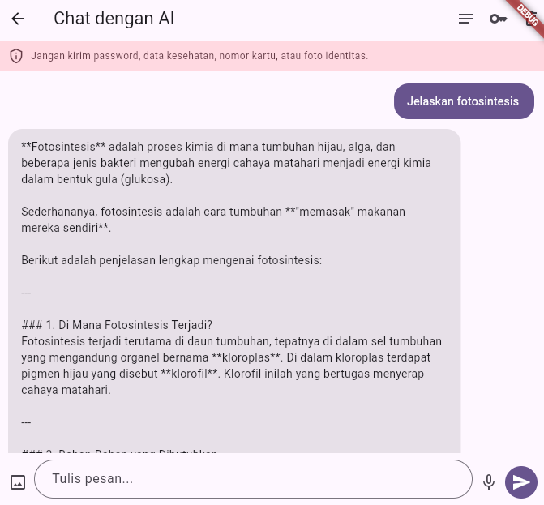
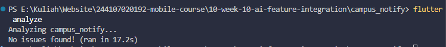
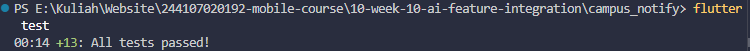

# Week 10 — Integrasi Fitur AI

## Mini Project: AI Assistant untuk Campus Notify

Fitur AI diintegrasikan ke aplikasi Flutter `campus_notify` melalui Gemini API.
Pengguna dapat:

- Bertanya lewat chat dengan jawaban streaming.
- Memilih foto dari kamera atau galeri untuk OCR atau deskripsi gambar.
- Merekam suara dan meminta transkripsi.
- Membuka catatan SQLite lokal saat AI tidak tersedia.

### Menjalankan aplikasi

```powershell
cd campus_notify
flutter pub get
flutter run
```

Di aplikasi, buka **Chat dengan AI**, tekan ikon kunci, lalu masukkan Gemini API
key dari [Google AI Studio](https://aistudio.google.com/apikey). Key disimpan
menggunakan `flutter_secure_storage`; jangan commit atau membagikannya. Fitur
kamera, galeri, dan mikrofon meminta izin platform saat digunakan. Gambar dan
audio dikirim ke Gemini untuk dianalisis.

Log prompt dan contoh output awal tersedia di [docs/ai-log.md](./docs/ai-log.md).
Kode aplikasi ada di [campus_notify/lib](./campus_notify/lib/), sementara
petunjuk fitur lengkap ada di [campus_notify/README.md](./campus_notify/README.md).

## Bukti Mesin Hijau

Perintah dijalankan dari folder `campus_notify`:

```powershell
flutter analyze
flutter test
```

| Pemeriksaan       | Hasil                             |
| ----------------- | --------------------------------- |
| `flutter analyze` | Lulus — `No issues found!`        |
| `flutter test`    | Lulus — seluruh 13 test berhasil. |

## Risiko dan Mitigasi

| Risiko                             | Mitigasi                                                                                                                                                                  |
| ---------------------------------- | ------------------------------------------------------------------------------------------------------------------------------------------------------------------------- |
| Data pribadi terkirim ke AI        | Dialog konfirmasi sebelum mengirim teks, gambar, dan rekaman. UI mengingatkan agar tidak mengirim password, data kesehatan, nomor kartu, atau dokumen identitas.          |
| Kuota/biaya API meningkat          | Maksimal 20 request baru per hari per perangkat, disimpan di secure storage. Maksimal 30 jawaban dicache selama aplikasi hidup; jawaban cache tidak membuat request baru. |
| Layanan API error atau offline     | Pesan error ramah, tombol **Coba lagi**, dan **Catatan offline** untuk membaca catatan lokal tanpa mengirimnya ke AI.                                                     |
| Respons tidak akurat/tidak relevan | Respons kosong ditolak; verifikasi informasi penting dan gunakan catatan offline sebagai sumber lokal. AI dapat keliru.                                                   |
| Batas lokal dilewati               | Batas 20 request adalah mitigasi praktikum di sisi klien, bukan kontrol per akun yang tahan manipulasi. Produk publik perlu validasi kuota di backend.                    |

## Screenshot

### Aplikasi

| Halaman utama                                                                           | Pengaturan Gemini API key                                                                  |
| --------------------------------------------------------------------------------------- | ------------------------------------------------------------------------------------------ |
|  |  |

| Layar chat AI                                                                          | Contoh hasil prompt                                                                             |
| -------------------------------------------------------------------------------------- | ----------------------------------------------------------------------------------------------- |
|  |  |

### Bukti mesin hijau

| `flutter analyze`                                                          | `flutter test`                                                      |
| -------------------------------------------------------------------------- | ------------------------------------------------------------------- |
|  |  |

Screenshot di atas menunjukkan hasil aplikasi dan verifikasi lokal. Pastikan
API key tetap tersembunyi dan jangan menambahkan screenshot yang berisi data
pribadi atau sensitif.

## Refleksi

### Fitur AI mana yang diintegrasikan dan mengapa?

Saya mengintegrasikan chat Gemini sebagai fitur utama Campus Notify. Chat
membuat pengguna bisa bertanya dengan bahasa natural; OCR/deskripsi gambar dan
transkripsi suara melengkapi input yang tidak praktis diketik, misalnya teks di
papan pengumuman atau pertanyaan lisan.

### Bagaimana melindungi privasi pengguna saat menggunakan AI API?

Pengguna melihat konfirmasi sebelum konten dikirim dan pengingat untuk tidak
mengirim informasi sensitif. API key disimpan dengan secure storage, tidak
ditulis di source code, dan dikirim lewat HTTPS. Rekaman suara sementara
dihapus setelah pemrosesan. Cache jawaban hanya berada di memori dan tidak
menyimpan gambar/audio. Untuk produksi, request dan kuota sebaiknya dimediasi
backend karena API key di aplikasi klien tetap dapat diekstrak.

### Fallback apa yang tersedia jika layanan AI error?

Chat menampilkan pesan sesuai jenis error dan menawarkan **Coba lagi**.
Pengguna dapat membuka **Catatan offline** dari SQLite lokal; catatan tidak
diteruskan ke Gemini. Fallback ini membantu akses ke data lokal, tetapi tidak
menggantikan jawaban AI untuk pertanyaan baru.

### Apa yang dipelajari tentang UX fitur AI di mobile?

Respons streaming dan indikator loading memberi umpan balik saat pengguna
menunggu. Izin kamera/mikrofon harus diminta sesuai konteks, pengiriman data
perlu transparan, dan tombol retry/fallback membuat kegagalan jaringan lebih
mudah dipahami. Batas durasi rekaman serta indikator rekaman juga mencegah
pengguna ragu apakah mikrofon masih aktif.
